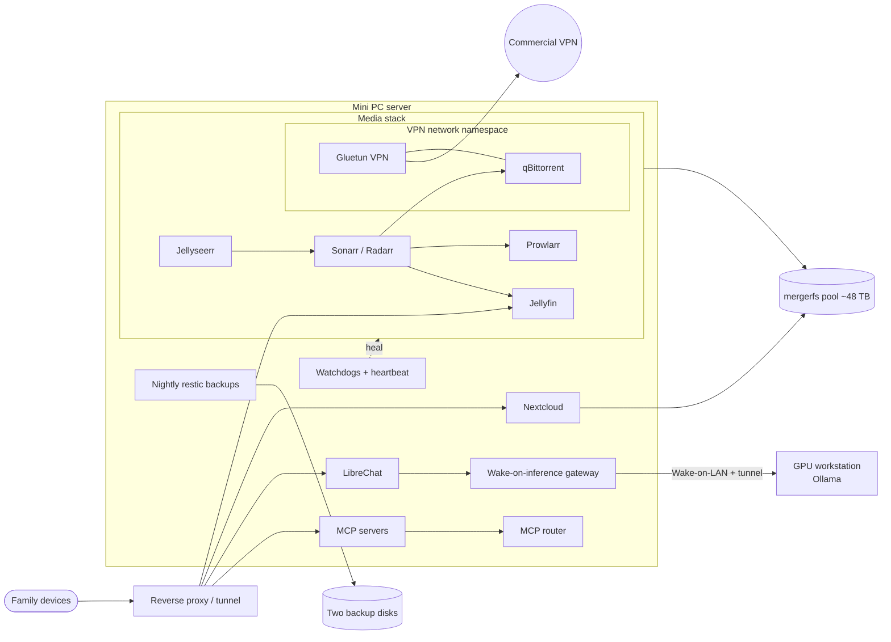

# Homelab

My self-hosted homelab. I started it in December 2020 and it has grown one
service at a time: media streaming and automation, a personal cloud, a local AI
chat site, custom MCP servers, and a layer of self-healing watchdogs that keeps
it all running without much hands-on work.

This repo is a write-up, not a full config dump. The [watchdogs](watchdogs/) and
the [example compose file](compose/) are real code from the server, cleaned up
for publication.

## Hardware

| Machine | Role |
|---|---|
| **Minisforum NAB6** mini PC (Intel i7-12650H) | Always-on server. Runs everything in Docker. |
| **~48 TB mergerfs pool** (4 disks) | Media, documents, photos, ROMs, backups. |
| **GPU workstation** (RTX 4070 Ti) | Off by default. Wakes over Wake-on-LAN when there's GPU work, then powers itself off when idle. |

## Services

**Media**
- Jellyfin for streaming, with Intel Quick Sync hardware transcoding.
- Sonarr, Radarr, Prowlarr, Bazarr and Jellyseerr for automated acquisition,
  subtitles and requests. Quality profiles are managed as code with Recyclarr.
- qBittorrent runs inside a Gluetun VPN container's network namespace. If the
  tunnel is down, the client has no network at all.
- A separate music pipeline that turns playlists into a lossless FLAC library
  tagged with beets.
- A small request widget injected into the Jellyfin UI, so users can request
  titles without leaving the player.

**Personal cloud**
- Nextcloud for files, calendar, contacts and photo sync, with face recognition.
- RomM for a retro game library.
- A Pterodactyl panel for hosting game servers.

**Local AI**
- LibreChat front end with Ollama models running on the GPU workstation.
- A **wake-on-inference gateway**: the chat site stays up while the GPU box is
  off. When a request targets a local model, the gateway wakes the workstation,
  waits for it to boot, opens a tunnel, preloads the model, and then streams the
  response. A cold start takes about 45 seconds. When the queue goes idle, the
  workstation shuts itself down.
- A self-hosted, sandboxed code interpreter and RAG over my own documents.

**Custom MCP servers** (Model Context Protocol, so AI assistants can use the lab)
- **Media**: one server covering Jellyfin, Sonarr, Radarr, Jellyseerr, Bazarr and
  the music pipeline.
- **Nextcloud**: about 115 tools over WebDAV, OCS and CalDAV.
- **Browser automation**: a hosted Playwright-based browser with per-conversation
  tab isolation and persistent sign-ins.
- **An MCP router** that puts all of these behind two tools (`search_tools` and
  `call_tool`), using embedding search. Small local models can then work with
  hundreds of tools without filling their context.

**Operations**
- About 30 cron and systemd watchdogs that detect and heal specific failure
  modes (see [watchdogs/](watchdogs/)).
- A foundation-level heartbeat that watches the watchdogs.
- Nightly backups with restic to two separate disks, written directly to the
  disks rather than through the pool, with freshness markers that the heartbeat
  checks.
- A userspace out-of-memory guard and per-container memory limits, added after
  the host locked up from memory pressure.

## Architecture



## Lessons learned

**1. "Running" isn't "working": the zombie VPN container.**
The VPN container's WireGuard tunnel died, but the container stayed `running
(unhealthy)`. Docker's restart policy only fires when a process exits, not when a
health check fails, so nothing restarted it. Downloads were silently dead for
about 36 hours. Three different watchdogs missed it, each in its own way: one read
a cached exit-IP file that outlives the tunnel, one waited for self-recovery and
never restarted anything, and one used `docker compose up -d`, which does nothing
to a container that's already running. The fixes were a live egress test through
the tunnel, a real restart, and a recreate of the client that shares the VPN's
network namespace (its namespace reference goes stale after a restart).

**2. Port forwarding can fail with every health check green.**
The VPN's NAT-PMP renewal timed out, but the forwarded-port file still showed the
old port. The torrent client went "firewalled", and downloads slowed to a trickle.
Then my own stall manager made it worse: it marked each stalled release as
failed, blocklisted it and searched again, and the next release stalled the same
way. One episode went through seven releases in ten hours. Now a dedicated
watchdog tests port reachability directly, and the stall manager won't act at all
while the client is firewalled.

**3. The slow downloads were a disk problem, not a network problem.**
Total throughput was stuck around 1 MB/s with a healthy tunnel and plenty of
peers. `iostat` showed the disks heavily busy with almost nothing being written:
qBittorrent's disk I/O mode was set to *write-through*, so every small piece write
was followed by an fsync. Switching to OS-cached writes raised throughput to about
50 MB/s. The API's integer values are also a trap: `0` isn't the default, it's
`O_DIRECT`.

**4. Pooled storage hides per-disk permissions.**
After a new disk was added to the mergerfs pool, creating a top-level folder
failed with `EACCES` even though the pool root was writable. mergerfs sends new
files to the emptiest disk, and that disk's branch root was owned by root. A later
version of the same bug was nastier: deletes failed for about a third of the files
in one folder, seemingly at random. The files that failed all lived on the one
disk whose copy of that subfolder had been recreated as root during a restore.
Now I compare the same path across *every* branch instead of trusting what the
pooled view shows.

**5. My own automation deleted a whole download session.**
A routine container recreate briefly broke the link between the *arr apps and
the download client. Every torrent then looked orphaned, and over six hours my
cleanup jobs removed more than 125 of them, some along with their data. The
worst offender was a queue cleaner that had a "stuck for N minutes" setting but
never actually used it. Fixes: a `keep` tag that every deletion path respects, a
circuit breaker (if more than a few items look orphaned at once, it's a
connection failure, so skip the run), and fail-safe behavior: if the client
can't be reached, delete nothing.

**6. One stale DNS setting, a dozen different errors.**
An uninstalled mesh-VPN client left a global DNS override pointing at a resolver
that only works from the host. Docker's embedded DNS copies the host's upstream
servers when a container starts, so containers started after that point couldn't
resolve anything. The symptoms looked unrelated: name-resolution errors, page-load
timeouts, 60-second hangs, and a config tool failing with a confusing error about
a color style. Every long-lived service now pins its DNS upstreams in compose.
After any host DNS change, I check name resolution in every container, not only
the ones that look broken.

## Repo layout

```
watchdogs/   representative self-healing scripts, plus a README on each
compose/     a cleaned-up example of the core media stack
```
